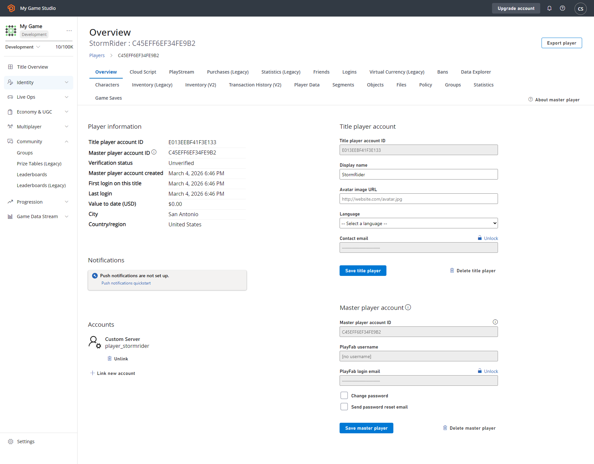
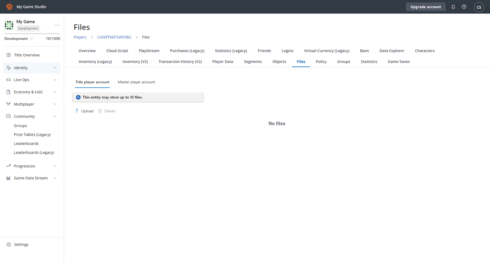

# Entity files

Entity files enable you to read and write files attached to an entity, in any format. The following example demonstrates a full entity-file loop, from signing in, to loading a file, and uploading a new file.

```csharp
#if !DISABLE_PLAYFABENTITY_API && !DISABLE_PLAYFABCLIENT_API

using PlayFab;
using PlayFab.Internal;
using System;
using System.Collections.Generic;
using System.Text;
using UnityEngine;

public class EntityFileExample : MonoBehaviour
{
    public string entityId; // Id representing the logged in player
    public string entityType; // entityType representing the logged in player
    private readonly Dictionary<string, string> _entityFileJson = new Dictionary<string, string>();
    private readonly Dictionary<string, string> _tempUpdates = new Dictionary<string, string>();
    public string ActiveUploadFileName;
    public string NewFileName;
    public int GlobalFileLock = 0; // Kind of cheap and simple way to handle this kind of lock

    void OnSharedFailure(PlayFabError error)
    {
        Debug.LogError(error.GenerateErrorReport());
        GlobalFileLock -= 1;
    }

    void OnGUI()
    {
        if (!PlayFabClientAPI.IsClientLoggedIn() && GUI.Button(new Rect(0, 0, 100, 30), "Login"))
            Login();
        if (PlayFabClientAPI.IsClientLoggedIn() && GUI.Button(new Rect(0, 0, 100, 30), "LogOut"))
            PlayFabClientAPI.ForgetAllCredentials();

        if (PlayFabClientAPI.IsClientLoggedIn() && GUI.Button(new Rect(100, 0, 100, 30), "(re)Load Files"))
            LoadAllFiles();

        if (PlayFabClientAPI.IsClientLoggedIn())
        {
            // Display existing files
            _tempUpdates.Clear();
            var index = 0;
            foreach (var each in _entityFileJson)
            {
                GUI.Label(new Rect(100 * index, 60, 100, 30), each.Key);
                var tempInput = _entityFileJson[each.Key];
                var tempOutput = GUI.TextField(new Rect(100 * index, 90, 100, 30), tempInput);
                if (tempInput != tempOutput)
                    _tempUpdates[each.Key] = tempOutput;
                if (GUI.Button(new Rect(100 * index, 120, 100, 30), "Save " + each.Key))
                    UploadFile(each.Key);
                index++;
            }
            // Apply any changes
            foreach (var each in _tempUpdates)
                _entityFileJson[each.Key] = each.Value;

            // Add a new file
            NewFileName = GUI.TextField(new Rect(100 * index, 60, 100, 30), NewFileName);
            if (GUI.Button(new Rect(100 * index, 90, 100, 60), "Create " + NewFileName))
                UploadFile(NewFileName);
        }
    }

    void Login()
    {
        var request = new PlayFab.ClientModels.LoginWithCustomIDRequest
        {
            CustomId = SystemInfo.deviceUniqueIdentifier,
            CreateAccount = true
        };
        PlayFabClientAPI.LoginWithCustomID(request, OnLogin, OnSharedFailure);
    }
    void OnLogin(PlayFab.ClientModels.LoginResult result)
    {
        entityId = result.EntityToken.Entity.Id;
        entityType = result.EntityToken.Entity.Type;
    }

    void LoadAllFiles()
    {
        if (GlobalFileLock != 0)
            throw new Exception("This example overly restricts file operations for safety. Careful consideration must be made when doing multiple file operations in parallel to avoid conflict.");

        GlobalFileLock += 1; // Start GetFiles
        var request = new PlayFab.DataModels.GetFilesRequest { Entity = new PlayFab.DataModels.EntityKey { Id = entityId, Type = entityType } };
        PlayFabDataAPI.GetFiles(request, OnGetFileMeta, OnSharedFailure);
    }
    void OnGetFileMeta(PlayFab.DataModels.GetFilesResponse result)
    {
        Debug.Log("Loading " + result.Metadata.Count + " files");

        _entityFileJson.Clear();
        foreach (var eachFilePair in result.Metadata)
        {
            _entityFileJson.Add(eachFilePair.Key, null);
            GetActualFile(eachFilePair.Value);
        }
        GlobalFileLock -= 1; // Finish GetFiles
    }
    void GetActualFile(PlayFab.DataModels.GetFileMetadata fileData)
    {
        GlobalFileLock += 1; // Start Each SimpleGetCall
        PlayFabHttp.SimpleGetCall(fileData.DownloadUrl,
            result => { _entityFileJson[fileData.FileName] = Encoding.UTF8.GetString(result); GlobalFileLock -= 1; }, // Finish Each SimpleGetCall
            error => { Debug.Log(error); }
        );
    }

    void UploadFile(string fileName)
    {
        if (GlobalFileLock != 0)
            throw new Exception("This example overly restricts file operations for safety. Careful consideration must be made when doing multiple file operations in parallel to avoid conflict.");

        ActiveUploadFileName = fileName;

        GlobalFileLock += 1; // Start InitiateFileUploads
        var request = new PlayFab.DataModels.InitiateFileUploadsRequest
        {
            Entity = new PlayFab.DataModels.EntityKey { Id = entityId, Type = entityType },
            FileNames = new List<string> { ActiveUploadFileName },
        };
        PlayFabDataAPI.InitiateFileUploads(request, OnInitFileUpload, OnInitFailed);
    }
    void OnInitFailed(PlayFabError error)
    {
        if (error.Error == PlayFabErrorCode.EntityFileOperationPending)
        {
            // This is an error you should handle when calling InitiateFileUploads, but your resolution path might vary
            GlobalFileLock += 1; // Start AbortFileUploads
            var request = new PlayFab.DataModels.AbortFileUploadsRequest
            {
                Entity = new PlayFab.DataModels.EntityKey { Id = entityId, Type = entityType },
                FileNames = new List<string> { ActiveUploadFileName },
            };
            PlayFabDataAPI.AbortFileUploads(request, (result) => { GlobalFileLock -= 1; UploadFile(ActiveUploadFileName); }, OnSharedFailure); GlobalFileLock -= 1; // Finish AbortFileUploads
            GlobalFileLock -= 1; // Failed InitiateFileUploads
        }
        else
            OnSharedFailure(error);
    }
    void OnInitFileUpload(PlayFab.DataModels.InitiateFileUploadsResponse response)
    {
        string payloadStr;
        if (!_entityFileJson.TryGetValue(ActiveUploadFileName, out payloadStr))
            payloadStr = "{}";
        var payload = Encoding.UTF8.GetBytes(payloadStr);

        GlobalFileLock += 1; // Start SimplePutCall
        PlayFabHttp.SimplePutCall(response.UploadDetails[0].UploadUrl,
            payload,
            FinalizeUpload,
            error => { Debug.Log(error); }
        );
        GlobalFileLock -= 1; // Finish InitiateFileUploads
    }
    void FinalizeUpload(byte[] body) // body is unused in this example
    {
        GlobalFileLock += 1; // Start FinalizeFileUploads
        var request = new PlayFab.DataModels.FinalizeFileUploadsRequest
        {
            Entity = new PlayFab.DataModels.EntityKey { Id = entityId, Type = entityType },
            FileNames = new List<string> { ActiveUploadFileName },
        };
        PlayFabDataAPI.FinalizeFileUploads(request, OnUploadSuccess, OnSharedFailure);
        GlobalFileLock -= 1; // Finish SimplePutCall
    }
    void OnUploadSuccess(PlayFab.DataModels.FinalizeFileUploadsResponse result)
    {
        Debug.Log("File upload success: " + ActiveUploadFileName);
        GlobalFileLock -= 1; // Finish FinalizeFileUploads
    }
}
#endif
```

## Deconstructing this example

- `GlobalFileLock` is a simplistic way to avoid file collisions, specifically designed for this example.
  - Independent file actions won't cause any issues.
  - Each file action requires many steps and multiple API calls, so don't try to access the same file in multiple ways at the same time.
  - If you're careful, you don't need any locking mechanism.
  - If you want to do something complicated, your locking mechanism might be much more complex.
- `OnGUI` is an old, but very dense way, to build a Unity GUI entirely within script.
  - Your GUI will be much better, and game-specific.
- All PlayFab features *first* require a login or authentication.
- `LoadAllFiles()` does exactly as it says. For the current signed-in entity, it loads all files saved to PlayFab.
  - This function requires multiple steps:
    - Asking PlayFab where the files are located,
    - And then downloading them separately.  
- `UploadFile(string fileName)` saves the file to the service for the entity.
  - For simplicity, this example saves one file at a time, but you can upload files atomically in sets as well.
  - The steps for this operation are:
    - Initialize an atomic upload operation,
    - Upload all files,
    - Finalize an atomic upload operation.
  - The entity doesn't consider the file upload complete, nor reflect any changes to other callers until the atomic upload operation is finalized successfully.

## File limits and pending uploads

Each entity has limits on how large a file can be and how many files it can hold. To see the current values for your title, go to Game Manager and select **Settings** > **Limits**.

| Limit | What it controls |
|-------|------------------|
| File size (`TitleFileSizeLimit`) | The maximum size of a single file. It applies to each file on its own, not to the total across all of an entity's files. |
| File count for title player accounts (`TitlePlayerAccountFileCount`) | The maximum number of files on a single title player account. |

### How uploads are counted

Uploading a file is a three step process: `InitiateFileUploads`, upload the data, then `FinalizeFileUploads`. Until the last step succeeds, the upload is pending.

- **File size is checked when you finalize.** `FinalizeFileUploads` measures the uploaded file and compares it to the file size limit. Other files on the entity are not added in. If the file is too large, the call returns `OverLimit` and the file is not saved. If you were replacing an existing file, the existing file is unchanged.
- **Pending uploads do not count toward the file size limit.** A file has no measured size until it is finalized.
- **A pending new file uses one of the entity's file slots.** The slot is reserved as soon as `InitiateFileUploads` succeeds, so it counts toward the file count limit even before you finalize.
- **A pending replacement does not use an extra slot.** It reuses the slot of the file it replaces, and the existing file stays live until the upload is finalized.

### Abandoned uploads

If you never finalize an upload, the service normally aborts it about 15 minutes after `InitiateFileUploads`. For a new file, this frees its slot. For a replacement, the existing file is unchanged.

To release a pending upload sooner, or if a slot is still held after 15 minutes, call `AbortFileUploads` with that file name.

`GetFiles` returns only files that have been finalized. It omits new files that are still pending, and it shows a pending replacement as its existing version. There is no read only call that lists pending uploads. If `InitiateFileUploads` returns `EntityFileOperationPending`, another upload of that file is still pending. It might belong to another client that is actively uploading, so wait for it to finish, or coordinate with that client first. Once you have confirmed the pending upload is abandoned, call `AbortFileUploads` for that file name and then start the upload again, as shown in the example above, which assumes only one client uploads a file at a time.
## Game Manager and entities

The Game Manager allows you to manipulate objects and files for players. The player overview has been updated to show both the title player and master player account information.

  

Also, the **Players** tab now includes separate sections for files and objects.

  

## Related features

Entity objects and files are used across several PlayFab features, each scoped to a different entity type:

| Feature | Entity types | Use case |
|---------|-------------|----------|
| [Game Server Configuration](../index.md) | `game_server` | Server-side settings and server-authoritative data |
| [Title Data](../titledata/index.md) | `namespace`, `title` | Global key/value configuration shared across all players |
| [Player Data](../../../player-progression/player-data/index.md) | `title_player_account`, `master_player_account`, `character` | Per-player profile, progress, and preference storage |
| [Groups](../../../community/associations/groups/index.md) | `group` | Data shared within a player group or guild |
