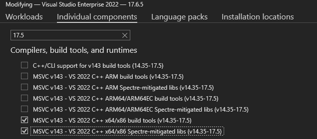

# PlayFab Unified SDK quickstart setup

## Requirements

- [PlayFab developer account](https://developer.playfab.com)
   - Complete [Quickstart: Game Manager](../../live-service-management/gamemanager/quickstart.md) to set up your PlayFab account.
- [Visual Studio 2019 or 2022](https://visualstudio.microsoft.com/)
   - For GDK development, see [SDK & tools requirements](/gaming/gdk/_content/gc/getstarted/overviews/sdk-and-tools#install-visual-studio)

## Project Setup

Download and install the October 2025 (or later) Microsoft Game Development Kit (GDK), which includes the PlayFab Unified SDK.

### Configure Project Compilation and Linking

1. **Additional Include Directories**
   - Right-click your Visual Studio project and select **Properties**.
   - Go to **C/C++ > General**.
   - Add the SDK's `include` folder (e.g., `$(GameDKLatest)\windows\include`) to **Additional Include Directories**.
2. **Preprocessor Definitions**
   - Go to **C/C++ > Preprocessor**.
   - Add `_GAMING_DESKTOP` to **Preprocessor Definitions** for every configuration.
   - The SDK headers use this define to select the GDK platform. The **Gaming.Desktop.x64** platform defines it automatically, but the stock **x64** platform doesn't. For more information, see [Using the x64 platform with the Microsoft Game Development Kit (GDK)](/gaming/gdk/docs/tools/tools-pc/visualstudio/gr-vs-templates#using-the-x64-platform-with-the-microsoft-game-development-kit-gdk).
3. **Additional Library Directories**
   - Go to **Linker > General**.
   - Add the SDK's `lib` folder (e.g., `$(GameDKLatest)\windows\lib\x64`) to **Additional Library Directories**.
4. **Additional Dependencies**
   - Go to **Linker > Input**.
   - Add the required SDK `.lib` files from the SDK's `lib` folder to **Additional Dependencies** (e.g., `xgameruntime.lib`, `PlayFabCore.lib`, `PlayFabServices.lib`, `PlayFabMultiplayer.lib`, `Party.lib` etc.).
5. **Runtime Dependencies**
   - Copy the required SDK `.dll` files from the SDK's `bin` folder (e.g., `$(GameDKLatest)\windows\bin\x64`) to your project's output directory (e.g., `libHttpClient.dll`, `PlayFabCore.dll`, `PlayFabServices.dll`, `PlayFabMultiplayer.dll`, `Party.dll`, etc.).

### Troubleshooting setup issues

If the compiler reports that SDK functions such as [PFInitialize](../../api-references/c/pfcore/functions/pfinitialize.md) are undefined (for example, `C3861: 'PFInitialize': identifier not found`), check that `_GAMING_DESKTOP` is in your project's **Preprocessor Definitions**. Without it, the SDK headers compile for a non-GDK Windows platform and don't declare these functions.

If you encounter linking issues, ensure Visual Studio build tools and libraries (version 17.5 or later) are installed. In Visual Studio Installer, select **Modify** for VS2022 and add the required components.

